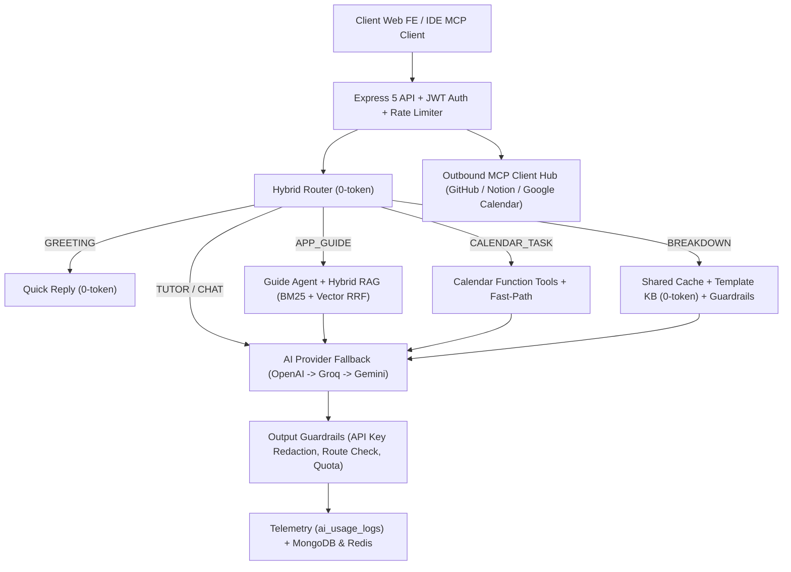

# TaskMind AI — Backend

> Hệ thống **quản lý công việc và lập lịch thông minh bằng AI** — kết hợp thuật toán lập lịch Hybrid, kiến trúc AI 8 tầng kiểm soát chi phí/an toàn, và giao thức MCP 2 chiều trên nền Node.js + TypeScript.

---

## Bài toán & Giá trị cốt lõi

Người dùng thường gặp 3 vấn đề khi quản lý thời gian:
1. Có danh sách việc cần làm lớn nhưng không biết **chia nhỏ** và ước lượng thời gian thực tế.
2. Không biết **xếp việc vào giờ nào** để không đè lên lịch cố định, thói quen sinh hoạt hằng ngày và giờ làm việc hiệu quả.
3. Gặp tình trạng quá tải hoặc lỡ lịch cần **điều phối lại (reschedule)** nhanh mà không phải xếp tay từ đầu.

**TaskMind AI Backend** giải quyết bài toán này bằng sự kết hợp giữa **thuật toán lập lịch xác định (deterministic algorithms)** và **LLM có kiểm soát** (Router 0-token, Template Fast-Path, Shared Redis Cache, Hybrid RAG, Guardrails và Eval tự động).

---

## Kiến trúc hệ thống & Luồng AI 8 tầng



### Đối chiếu 8 tầng Production AI trong Backend

| Tầng | Triển khai thực tế | File chính |
|---|---|---|
| **1. Model** | Đa provider (`OpenAI` → `Groq` → `Gemini`) tự fallback khi rate-limit/lỗi mạng; bù headroom thinking token cho `gemini-2.5-flash`. | `src/modules/ai/ai.provider.ts` |
| **2. System Prompt** | Tách prompt theo đúng nhánh intent, loại bỏ context thừa khỏi hội thoại thông thường. | `src/modules/ai/ai-intent.ts` |
| **3. RAG** | **Hybrid Search (BM25 + Vector Embedding + Reciprocal Rank Fusion)** trên 5 module KB Markdown (`tasks`, `calendar`, `teams`, `notifications`, `chat-and-profile`), mở rộng từ viết tắt tiếng Việt và fallback offline `local:char-ngram-256`. | `src/modules/ai/agents/kb-retriever.service.ts`, `embedding.service.ts` |
| **4. Tools & MCP** | 5 server-side Function Calling tool + **MCP 2 chiều** (`@modelcontextprotocol/sdk`): Inbound Server (`6 tools + 1 resource`) qua `/mcp` HTTP & `stdio`, và Outbound Client Hub (`/mcp/connectors`). | `src/modules/ai/ai-tools.ts`, `src/modules/ai/mcp/` |
| **5. Phân quyền** | JWT / HttpOnly cookie (`authMiddleware`), `aiLimiter` (20 req/phút/user), `userId` luôn bind từ server — không tin ID từ LLM; Outbound MCP khoá whitelist chống SSRF. | `src/middleware/auth.middleware.ts`, `src/modules/ai/mcp/mcp-connectors.config.ts` |
| **6. Rào chắn** | Input guardrails (chặn prompt injection Anh/Việt, giới hạn độ dài), Output guardrails (che key rò rỉ, gỡ route Markdown không hợp lệ), giới hạn token ngày trên Redis, Jaccard grounding check cho Breakdown. | `src/modules/ai/agents/ai-guardrails.service.ts`, `ai-breakdown.service.ts` |
| **7. Cache + Router** | Hybrid Router 0-token + Shared Breakdown Cache 24h (tái sử dụng giữa các user) + 8 Breakdown Templates 0-token + Redis Guide Cache. | `src/modules/ai/agents/agent-router.ts`, `ai.cache.service.ts`, `breakdown-templates.ts` |
| **8. Giám sát + Eval** | Log chi tiết token, cost ước tính, latency, cacheHit, guardrail flags vào `ai_usage_logs` (`GET /ai/usage-summary`) + bộ benchmark tự động `npm run ai:eval` & `npm run mcp:test`. | `src/modules/ai/ai-usage.service.ts`, `src/modules/ai/eval/` |

---

## Thuật toán lập lịch lõi

> Chi tiết toán học & ví dụ minh hoạ: **[ALGORITHMS.md](./ALGORITHMS.md)**

| # | Thuật toán | Vai trò trong bài toán xếp lịch | File chính |
|---|---|---|---|
| 1 | **Binary Search Conflict Detection** | Kiểm tra trùng lịch `O(log n)` trên tập slot đã sắp xếp | `src/modules/scheduler/` |
| 2 | **Bayesian Productivity Scoring** | Chấm điểm năng suất theo khung giờ từ lịch sử hoàn thành | `src/modules/scheduler/` |
| 3 | **Multi-Factor Weighted Scoring** | Chấm điểm slot trống theo 5 tiêu chí (năng suất, urgency, độ khớp thời lượng...) | `src/modules/scheduler/` |
| 4 | **Interval Merging + Adaptive Buffer** | Gộp khoảng bận (gồm Daily Routines co giãn), chèn khoảng nghỉ hợp lý | `src/modules/scheduler/` |
| 5 | **Hybrid AI + Heuristic Estimation** | Chia nhỏ công việc lớn thành các phiên làm việc kèm kiểm tra bám sát spec | `src/modules/ai/ai-breakdown.service.ts`, `hybrid-schedule.service.ts` |

---

## Tích hợp MCP 2 chiều (Model Context Protocol)

> Hướng dẫn cấu hình & test chi tiết: **[MCP_GUIDE.md](./MCP_GUIDE.md)** · File mẫu IDE: **[.mcp.example.json](./.mcp.example.json)**

- **Chiều VÀO (`TaskMind MCP Server`)**:
  - Mount tại `POST /mcp` (Stateless Streamable HTTP, bảo vệ bởi JWT) và `npm run mcp:stdio` (dành cho Cursor, Claude Desktop, VS Code, Antigravity).
  - Cung cấp 6 tool (`list_tasks`, `create_task`, `breakdown_task`, `get_free_busy`, `propose_schedule`, `search_kb`) và resource `taskmind://kb/overview`.
- **Chiều RA (`Outbound MCP Client Hub`)**:
  - Endpoint `GET /mcp/connectors`, `POST /mcp/connectors/:id/tools`, `POST /mcp/connectors/:id/call` kết nối tới `github`, `notion`, `google_calendar` với token riêng theo từng user (`x-mcp-token` hoặc Google OAuth), timeout 15s và output guardrail.

---

## Cấu trúc dự án

```text
src/
├── config/                 # Database, Passport (Google OAuth), Redis & cache versioning
├── middleware/             # JWT auth middleware, validation, rate limiters
├── modules/
│   ├── ai/
│   │   ├── agents/         # Hybrid router, Guide agent, Guardrails, Hybrid RAG, Breakdown templates
│   │   ├── mcp/            # TaskMind MCP Server (/mcp, stdio) & Outbound MCP Client Hub
│   │   ├── kb/             # Markdown Knowledge Base (tasks, calendar, teams, notifications, profile)
│   │   ├── eval/           # Automated AI Eval (run-eval.ts) & MCP Test (test-mcp.ts)
│   │   ├── ai-breakdown.service.ts
│   │   ├── ai-chat.service.ts
│   │   ├── ai-usage.service.ts
│   │   └── ai.provider.ts
│   ├── scheduler/          # Hybrid scheduling, slot finder, productivity scorer, adaptive buffer
│   ├── task/               # CRUD tasks, AI breakdown persistence, calendar events
│   ├── free-time/          # User availability slots
│   ├── routine/            # Daily routines & flexible exclusion rules
│   ├── ai-schedule/        # AI schedule plans
│   ├── notification/       # Deadline/session reminder cron, Snooze, Quiet Hours, Digest Email + BullMQ
│   ├── auth/ & user/       # Register (OTP), Login, Google OAuth 2.0, JWT refresh, user habits
│   ├── team/, chat/, guest/# Collaboration extensions (Teams, Realtime Socket.IO Messenger, Guests)
│   └── admin/, catalog/, colors/
├── services/               # Redis (với fallback BullMQ an toàn), Mail, Cloudinary, Cron cleanup
├── app.ts                  # Express 5 app setup, CORS, Helmet, routes
└── server.ts               # Bootstrap HTTP + Socket.IO + Swagger + Cron
```

---

## Tech Stack

| Layer | Technology |
|---|---|
| Runtime | Node.js 22 + TypeScript 5.9 |
| Framework | Express 5 |
| Database | MongoDB (Mongoose 9) |
| Cache / Queue | Redis (`ioredis`) + BullMQ 5 |
| Real-time | Socket.IO 4 |
| AI Providers | OpenAI (`gpt-4o-mini`) · Groq (`llama-3.1-8b-instant`) · Google Gemini (`gemini-2.5-flash`, `gemini-embedding-001`) |
| Protocol | Model Context Protocol (`@modelcontextprotocol/sdk`) + Zod |
| Auth & Security | JWT (Access + Refresh), HttpOnly Cookies, Google OAuth 2.0, Helmet, Express Rate Limit |
| Docs & Testing | Swagger/OpenAPI (`/docs`), Jest, Supertest, fast-check, AI Eval Suite |

---

## Cài đặt & Chạy local

```bash
# 1. Cài đặt thư viện
npm install

# 2. Tạo file biến môi trường
cp .env.example .env
# -> Điền MONGO_URL, REDIS_HOST/PORT, JWT secrets và ít nhất 1 AI key (GEMINI_API_KEY / GROQ_API_KEY / OPENAI_API_KEY)

# 3. Khởi động Redis (Docker hoặc Redis service local)
docker compose -f docker-compose.local.yml up -d

# 4. Chạy dev server (mặc định http://localhost:3002)
npm run dev

# 5. Build production
npm run build
npm start
```

- **Swagger API Docs**: `http://localhost:3002/docs`
- **Health Check**: `http://localhost:3002/healthz`

---

## Kiểm thử & Đánh giá (Verification & Eval)

```bash
# Kiểm tra kiểu TypeScript nghiêm ngặt
npm run ts.check

# Chạy bộ Eval AI 4 tầng (Router 16 cases, Hybrid RAG 12 cases, Guardrails 8 cases, Breakdown Optimization 8 cases)
npm run ai:eval

# Chạy kiểm thử Eval với Vector Embedding live + Redis
npm run ai:eval -- --live-embeddings --with-redis

# Chạy bộ kiểm thử giao thức MCP 2 chiều (Inbound Server + Express /mcp + Outbound Client Hub)
npm run mcp:test

# Chạy unit & integration test suite
npm test
```

Kết quả đo kiểm gần nhất:
- `npm run ts.check`: **PASS** (0 lỗi)
- `npm run ai:eval`: **44/44 cases PASS (100%)** (`Router 16/16`, `Hybrid RAG 12/12`, `Guardrails 8/8`, `Breakdown Optimization 8/8`)
- `npm run mcp:test`: **15/15 checks PASS (100%)**

---

## Repository liên quan

- **Frontend (React 19 + Vite + Ant Design 6)**: [FE-Task-Calendar-Managerment](https://github.com/tuananh271020k5/FE-Task-Calendar-Managerment)
